<picture><source media="(prefers-color-scheme: dark)" srcset="assets/hero-dark.svg"></picture>

I take products from a blank page to production by myself: product thinking, system design, code on every layer, testing, security, release and operation. I've done it since 2015, starting with my own [PHP](https://github.com/Mr-vero/Framework-F) and [Ruby](https://github.com/Mr-vero/Commuter) web frameworks. **If it can be imagined, I can build it.** Every card below opens the real project.

 

<picture><source media="(prefers-color-scheme: dark)" srcset="assets/section-work-dark.svg"></picture>

  <a href="https://github.com/Mr-vero/hop"><picture><source media="(prefers-color-scheme: dark)" srcset="assets/card-hop-dark.svg"></picture></a>
  <a href="https://github.com/Mr-vero/audit-rag"><picture><source media="(prefers-color-scheme: dark)" srcset="assets/card-audit-rag-dark.svg"></picture></a>

  <a href="https://github.com/Mr-vero/letterbox"><picture><source media="(prefers-color-scheme: dark)" srcset="assets/card-letterbox-dark.svg"></picture></a>
  <a href="https://github.com/Mr-vero/produkpos"><picture><source media="(prefers-color-scheme: dark)" srcset="assets/card-produkpos-dark.svg"></picture></a>

  <a href="https://github.com/Mr-vero/inKey"><picture><source media="(prefers-color-scheme: dark)" srcset="assets/card-inkey-dark.svg"></picture></a>
  <a href="https://www.npmjs.com/package/ava-engine"><picture><source media="(prefers-color-scheme: dark)" srcset="assets/card-ava-dark.svg"></picture></a>

  <a href="https://github.com/Mr-vero/clippy"><picture><source media="(prefers-color-scheme: dark)" srcset="assets/card-clippy-dark.svg"></picture></a>
  <a href="https://mr-vero.github.io/the-last-ember/"><picture><source media="(prefers-color-scheme: dark)" srcset="assets/card-ember-dark.svg"></picture></a>

 

<picture><source media="(prefers-color-scheme: dark)" srcset="assets/lifecycle-dark.svg"></picture>

**Proof:** [six architecture decisions](https://github.com/Mr-vero/audit-rag#six-decisions-worth-defending) · [eval gate in CI](https://github.com/Mr-vero/audit-rag) · [letterbox CI](https://github.com/Mr-vero/letterbox/actions) · [hop protocol spec](https://github.com/Mr-vero/hop/blob/main/PROTOCOL.md) · [hop releases](https://github.com/Mr-vero/hop/releases) · [Ava Engine on npm](https://www.npmjs.com/package/ava-engine) · [produkpos security model](https://github.com/Mr-vero/produkpos#security-model) · [Framework-F](https://github.com/Mr-vero/Framework-F) · [Commuter](https://github.com/Mr-vero/Commuter)

 

<picture><source media="(prefers-color-scheme: dark)" srcset="assets/timeline-dark.svg"></picture>

 

<picture><source media="(prefers-color-scheme: dark)" srcset="assets/toolbox-dark.svg"></picture>

 

<a href="mailto:Mr.vero@usa.com"><picture><source media="(prefers-color-scheme: dark)" srcset="assets/cta-dark.svg"></picture></a>
