<picture>
  <source media="(prefers-color-scheme: dark)" srcset="assets/hero-dark.svg">
  
</picture>

<br>

I take products from a blank page to production by myself: product thinking, system design, code on every layer, testing, security, release and operation. I've been doing it since 2015, starting with my own [PHP](https://github.com/Mr-vero/Framework-F) and [Ruby](https://github.com/Mr-vero/Commuter) web frameworks, and today across AI systems, native Apple and Android apps, and web platforms.

If it can be imagined, I can build it, and the projects below are the proof.

<p>
  <a href="mailto:Mr.vero@usa.com"></a>
  
</p>

## Selected work

<table>
<tr>
<td width="50%" valign="top">

### [hop](https://github.com/Mr-vero/hop) &nbsp;·&nbsp; <sub>macOS + Android</sub>
Apple-style Continuity for Android phones and Macs: notifications and calls in the notch, a shared clipboard, auto-filled SMS codes, file transfer and full phone mirroring.

**The hard part:** I designed [the wire protocol](https://github.com/Mr-vero/hop/blob/main/PROTOCOL.md) myself: QR pairing with a 32-byte key, a fresh HMAC-SHA256 session key per connection, AES-256-GCM on every frame, replay protection, and Bluetooth proximity with rotating tokens. No cloud, no account.

`Swift` `Kotlin` `Cryptography` `Networking` · [v1.1.0 released](https://github.com/Mr-vero/hop/releases/latest)

</td>
<td width="50%" valign="top">

### [audit-rag](https://github.com/Mr-vero/audit-rag) &nbsp;·&nbsp; <sub>AI engineering</sub>
Question answering over audit documents, built for a regulated setting where every claim must trace to a source.

**The hard part:** hybrid retrieval (pgvector HNSW + Postgres full-text, fused with Reciprocal Rank Fusion), cross-encoder reranking, enforced abstention, citation validation, tenant isolation inside the SQL, and a golden-set evaluation harness that **fails the CI build** when quality drops.

`TypeScript` `PostgreSQL` `pgvector` `LLM evaluation`

</td>
</tr>
<tr>
<td width="50%" valign="top">

### [letterbox](https://github.com/Mr-vero/letterbox) &nbsp;·&nbsp; <sub>macOS app + AI</sub>
<a href="https://github.com/Mr-vero/letterbox"></a>

A native mail client for any IMAP provider, organized by Claude: daily briefings, reply tracking, deadline timelines, drafting and inbox-wide questions. Dependency-free SwiftUI, a local SQLite cache for instant launch, and CI on every push.

`Swift 6` `SwiftUI` `IMAP/SMTP` `SQLite` `Claude`

</td>
<td width="50%" valign="top">

### [produkpos](https://github.com/Mr-vero/produkpos) &nbsp;·&nbsp; <sub>API + PWA</sub>
<a href="https://produkpos.vercel.app/pos/"></a>

A public REST API of 4,600+ Indonesian retail products and a free, offline-first cashier app for small shops. SQLite FTS5 search at about 1 ms per query, rate limiting, schema-validated input and [live API docs](https://produkpos.vercel.app/docs).

`Node.js` `SQLite FTS5` `PWA` `REST API` · [Live →](https://produkpos.vercel.app/pos/)

</td>
</tr>
<tr>
<td width="50%" valign="top">

### [inKey](https://github.com/Mr-vero/inKey) &nbsp;·&nbsp; <sub>Android + computer vision</sub>
A system-wide Android keyboard that lets you type on an empty table using only the front camera.

**The hard part:** MediaPipe hand tracking at 21 landmarks per hand, One-Euro filtering, a palm-relative tap detector, gesture typing decoded from path shape, and a 20k-word / 100k-bigram language model that turns noisy taps into words.

`Kotlin` `CameraX` `MediaPipe` `Probabilistic decoding`

</td>
<td width="50%" valign="top">

### [Ava Engine](https://www.npmjs.com/package/ava-engine) &nbsp;·&nbsp; <sub>Voice AI agent</sub>
A screen-aware voice agent that sees the tab a customer shares, talks them through the product, and hands off to a human when needed. Published on npm, with a [public playbook library](https://github.com/Mr-vero/ava-playbooks) that installs from its dashboard.

`TypeScript` `Voice AI` `Agents` `npm`

</td>
</tr>
<tr>
<td width="50%" valign="top">

### [clippy](https://github.com/Mr-vero/clippy) &nbsp;·&nbsp; <sub>macOS utility</sub>
A clipboard manager in about 1 MB with zero dependencies and zero network calls: unlimited history, paste at the cursor, and conflict-free iCloud sync built on per-device journals and tombstones. [Try the demo →](https://clippyone.vercel.app)

`Swift 6` `AppKit` `Sync design`

</td>
<td width="50%" valign="top">

### [The Last Ember](https://github.com/Mr-vero/the-last-ember) &nbsp;·&nbsp; <sub>Game</sub>
A six-chapter, story-driven adventure for the mobile web. Every visual is drawn live on canvas, every sound is synthesised with the Web Audio API, and the final boss has four phases. One file, no assets. [Play it →](https://mr-vero.github.io/the-last-ember/)

`JavaScript` `Canvas` `Web Audio` `Game design`

</td>
</tr>
</table>

## How I work, end to end

| Stage | What I do | Where to see it |
| --- | --- | --- |
| **Product** | Find the real problem, cut scope to what matters, write the docs a user actually needs | Every README above starts with *why* |
| **Architecture** | Choose the boring tool when it wins, and write down the trade-offs | [audit-rag: six decisions worth defending](https://github.com/Mr-vero/audit-rag#six-decisions-worth-defending) |
| **Build** | Native Swift and Kotlin, TypeScript and Node, Python, plus my own frameworks when nothing fits | [Framework-F](https://github.com/Mr-vero/Framework-F), [Commuter](https://github.com/Mr-vero/Commuter) |
| **Test** | Automated CI, evaluation harnesses with quality gates, ablation studies | [audit-rag eval gate](https://github.com/Mr-vero/audit-rag), [letterbox CI](https://github.com/Mr-vero/letterbox/actions) |
| **Security** | Threat-model first: end-to-end encryption, tenant isolation, rate limiting, private by default | [hop protocol spec](https://github.com/Mr-vero/hop/blob/main/PROTOCOL.md) |
| **Ship** | Versioned releases, installable PWAs, landing pages, published packages | [hop releases](https://github.com/Mr-vero/hop/releases), [Ava Engine on npm](https://www.npmjs.com/package/ava-engine) |
| **Operate** | Performance budgets, abuse protection, honest data licensing | [produkpos security model](https://github.com/Mr-vero/produkpos#security-model) |

## Toolbox

**Languages:** TypeScript · JavaScript · Python · Swift · Kotlin · PHP · Ruby · Objective-C
**AI:** RAG · hybrid search · reranking · LLM evaluation · agents · voice AI · Claude · MediaPipe
**Platforms:** macOS (SwiftUI, AppKit) · Android (CameraX, IME) · Web (PWA, Canvas, Web Audio) · Node.js APIs
**Data and infra:** PostgreSQL · pgvector · SQLite FTS5 · GitHub Actions · Vercel · GitHub Pages

## Ten years of building

```
2015  Joined GitHub
2016  Wrote my own PHP MVC framework (Framework-F)
2018  Wrote a Ruby MVC web framework (Commuter) and a live in-browser code editor
2024  AI products: AutoTranslate (SeamlessM4T), TagBook, ParaphraseDoctor
2025  2,800+ contributions in one year
2026  hop, letterbox, audit-rag, inKey, Ava Engine, produkpos, The Last Ember
```

## Let's build something

I'm open to **full-time roles** where one person owning a product from idea to production is an advantage. Send me the hardest problem on your roadmap: **[Mr.vero@usa.com](mailto:Mr.vero@usa.com)**
